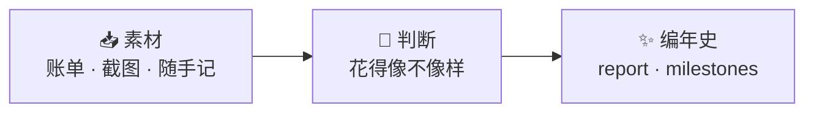

# StepLedger 跬步账

[](https://github.com/Nanaqiay001/StepLedger/actions/workflows/ci.yml)

> 每天一句话，攒出 100 万编年史。

把当天的收支随手丢进来，AI 回一段有温度的复盘：最近钱花得怎么样、下一步怎么调，
以及你离 100 万还有多远。

```console
$ uv run --no-project scripts/daily_run.py --text "午饭 35，打车 22，工资到账 18000"

# 2026-10-28 · 跬步账
最近怎么样：今天工资到账 18000，账面上先亮了一下。花出去的都是些零碎小钱，
看着挺克制的，没有大手大脚。
下一步怎么走：趁工资刚到的这份新鲜劲，顺手把一小笔挪到不常看的账户里，就当
先给未来的自己留个位置。
进度：░░░░░░░░░░ 1.3%　还差 ¥987,136
```

## 它不是什么

**定性，不定量。** 不做精确对账、不做预算超支判定、不出损益表。它只回答「最近花钱
是什么感觉」和「下一步可以怎么调」——判断仅供参考，但说人话。归档一天天连起来，
就是一部慢慢变厚的编年史。

## 管线



采集 / 判断 / 渲染三层职责单一，层间以**文件**为界，任何一层都能单独重跑：

```bash
uv run --no-project scripts/daily_run.py --stage collect --file ~/Downloads/bill.md   # 只收素材
uv run --no-project scripts/daily_run.py --stage judge                               # 只重跑 AI 判断
uv run --no-project scripts/daily_run.py --stage render                              # 只重画结果
```

想让快捷指令写进 iCloud 的素材夹每天自动收进来：`.env` 里写一行 `COLLECT_SOURCE_DIRS=<素材夹>` 即可。
判断层默认用本地模板，离线、不花钱；`.env` 里填 `JUDGE_API_KEY`（任意 OpenAI 兼容网关）
就换成真模型，调不通会自动退回模板，并在报告里标「降级模式」。

## 每天留下什么

```
materials/YYYY-MM-DD/     # 当天素材（文件名带内容哈希，重复投递不产生副本）
archive/YYYY-MM-DD/
├── prompt.md             # 当天发给 AI 的 prompt（必须归档）
├── judgment.json         # 总结 / 建议 / 进度快照
├── report.md             # 给人看的复盘
└── milestones.md         # 里程碑与最近进度
```

## 开发

```bash
uv run --no-project --with pytest python -m pytest   # 默认跳过 integration
uv run --no-project python scripts/privacy_scan.py   # 隐私扫描，零匹配才算过
```

CI 门禁见 [`.github/workflows/ci.yml`](.github/workflows/ci.yml)。

更多：[PRD](docs/prd.md) · [RFC](docs/rfc.md) · [测试策略](docs/test.md) · [工作日志](docs/working.md)

## 致谢

启发自 [grapeot/eink_diary](https://github.com/grapeot/eink_diary)。
