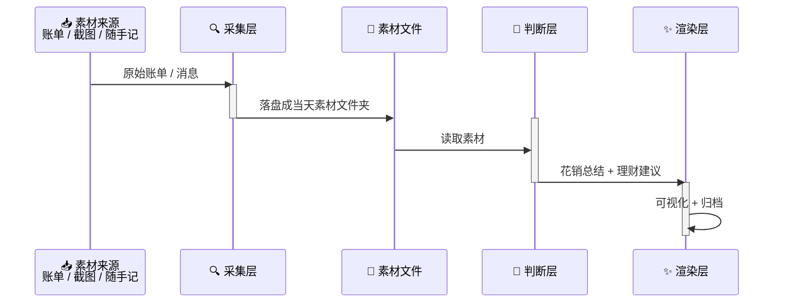

# StepLedger 跬步账

[](https://github.com/Nanaqiay001/StepLedger/actions/workflows/ci.yml)

> 你距离 100 万有多远？每天把各方收支素材收进来，让 AI 说一句"最近钱花得怎么样、下一步怎么走"，悄悄攒成 100 万编年史。

## 设计取向

**定性，不定量。** 不做精确对账，不做预算超支判定。AI 给的是"最近花钱是什么感觉"和"可以怎么调"，不是一张损益表——但必须有温度，说人话。

## 总体管线



各层职责单一、可独立替换，层间以**文件**为界：

1. **采集层（collect）** — 从各方收拢素材，只落成文件，不做解读
2. **判断层（judge）** — 读素材，产出「最近花销总结 + 理财建议」，仅供参考，重温度不重严谨
3. **渲染层（render）** — 把判断结果可视化（终端 / 图片 / 网页），并归档

## 快速开始

项目零运行时依赖，只需要 Python ≥ 3.11。

```bash
# 1. 创建虚拟环境
uv venv

# 2. 配置（可选；默认用本地模板判断，不调模型）
cp .env.example .env

# 3. 投一段素材，跑完整管线
.venv/bin/python scripts/daily_run.py --text "午饭 35，打车 22，工资到账 18000"

# 或者投一个账单文件
.venv/bin/python scripts/daily_run.py --file ~/Downloads/bill.md

# 想每天自动收一个素材夹（例如快捷指令写进 iCloud 的银行记录）：
# .env 里加一行 COLLECT_SOURCE_DIRS=~/Library/Mobile Documents/com~apple~CloudDocs/<素材夹名>
.venv/bin/python scripts/daily_run.py --stage collect

# 查看归档
ls materials/2026-10-28 archive/2026-10-28
```

同一天重复执行会覆盖当天产物，不会产生第二个日期目录。任一层都可以单独重跑：

```bash
.venv/bin/python scripts/daily_run.py --stage collect --text "晚上买了本书 59"
.venv/bin/python scripts/daily_run.py --stage judge
.venv/bin/python scripts/daily_run.py --stage render
```

想把命令装进 PATH（可选）：`uv pip install .`，之后直接用 `step-ledger --text "..."`。

想换成真实模型：把 `.env` 里的 `JUDGE_PROVIDER` 改成 `openai` 并填 `JUDGE_API_KEY`
（任意 OpenAI 兼容网关都行，改 `JUDGE_BASE_URL`）。模型不可用时会自动退回本地模板，
并在产物里标注「降级模式」。

### 用 uv 跑（推荐）

```bash
./run                      # 完整一次：收素材 → 判断 → 渲染
./run --stage collect      # 只收素材
```

`./run` 等价于“把 `src/` 放进 PYTHONPATH，再用 `uv run python -m step_ledger`”，
不装包、不吃 uv 的本地包缓存，改完代码立刻生效。

> 别用裸 `uv run step-ledger`：uv 0.10 + CPython 3.13 下它会按可编辑方式装包，
> 写出以 `_` 开头的 `.pth` 被 `site.py` 跳过，偶尔报 `ModuleNotFoundError`；
> `--with .` / `--reinstall` 也可能复用旧 wheel，看不到新代码。

## 产物

```
materials/
├── profile.md               # 目标 / 存款 / 偏好（长期状态，跨天唯一事实源）
└── YYYY-MM-DD/              # 当天素材
archive/YYYY-MM-DD/
├── prompt.md                # 当天发给判断层的 prompt（必须归档）
├── judgment.json            # summary / advice + 进度快照
├── report.md                # 给人看的复盘
└── milestones.md            # 目标里程碑与最近进度
```

`profile.md` 里没填「当前存款」时，会由模型从素材里读出最新余额兜底，
并在报告里标注「AI 从素材识别」；手填的数字永远优先。

## 开发

```bash
uv pip install pytest
.venv/bin/python -m pytest          # 默认跳过 integration
.venv/bin/python scripts/privacy_scan.py
```

CI 跑的就是这两条命令（外加 Python 3.11–3.14 矩阵和一次 `pip install .` 安装冒烟），
配置在 [`.github/workflows/ci.yml`](.github/workflows/ci.yml)。

## 文档

- [产品需求文档（PRD）](docs/prd.md)
- [架构设计文档（RFC）](docs/rfc.md)
- [测试策略](docs/test.md)
- [工作日志](docs/working.md)

## 致谢

本项目受 [grapeot/eink_diary](https://github.com/grapeot/eink_diary) 启发，感谢原作者的开源分享。
