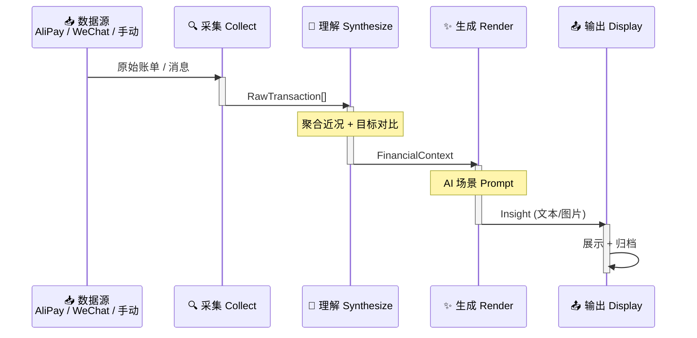

# StepLedger 跬步账

> 你距离100万有多远？每天通过收支记录采集，由 AI 每日解读收支是否偏离目标，让你每天离小目标近一点，最后攒成 100 万编年史。

## 总体管线



四个阶段职责单一、可独立替换：

1. **采集（collect）** — 从多个数据源适配器获取原始收支数据
2. **理解（synthesize）** — 聚合原始数据为结构化的近况上下文
3. **生成（render）** — AI 根据目标和上下文生成解读
4. **输出（display）** — 将解读结果输出给用户并归档

## 快速开始

```bash
# 1. 创建虚拟环境并安装依赖
uv venv
uv pip install -r requirements.txt

# 2. 配置环境变量
cp .env.example .env
# 编辑 .env 填入真实凭证

# 3. 运行
uv run python scripts/daily_run.py
```

## 文档

- [产品需求文档（PRD）](docs/prd.md)
- [架构设计文档（RFC）](docs/rfc.md)
- [测试策略](docs/test.md)
- [工作日志](docs/working.md)

## 致谢

本项目受 [grapeot/eink_diary](https://github.com/grapeot/eink_diary) 启发，感谢原作者的开源分享。
