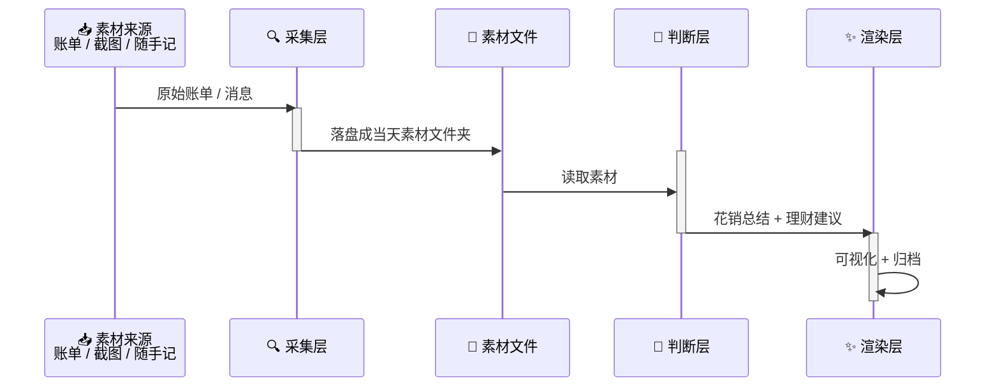

# StepLedger 跬步账

> 你距离 100 万有多远？每天把各方收支素材收进来，让 AI 说一句"最近钱花得怎么样、下一步怎么走"，悄悄攒成 100 万编年史。

## 设计取向

**定性，不定量。** 不做精确对账，不做预算超支判定。AI 给的是"最近花钱是什么感觉"和"可以怎么调"，不是一张损益表——但必须有温度，说人话。

## 总体管线



各层职责单一、可独立替换，层间以**文件**为界：

1. **采集层（collect）** — 从各方收拢素材，只落成文件，不做解读
2. **判断层（judge）** — 读素材，产出「最近花销总结 + 理财建议」，仅供参考，重温度不重严谨
3. **渲染层（render）** — 把判断结果可视化（终端 / 图片 / 网页），并归档

## 快速开始

```bash
# 1. 创建虚拟环境并安装依赖
uv venv
uv pip install -r requirements.txt

# 2. 配置环境变量
cp .env.example .env
# 编辑 .env 填入真实凭证

# 3. 运行
uv run python scripts/daily_run.py
```

## 文档

- [产品需求文档（PRD）](docs/prd.md)
- [架构设计文档（RFC）](docs/rfc.md)
- [测试策略](docs/test.md)
- [工作日志](docs/working.md)

## 致谢

本项目受 [grapeot/eink_diary](https://github.com/grapeot/eink_diary) 启发，感谢原作者的开源分享。
