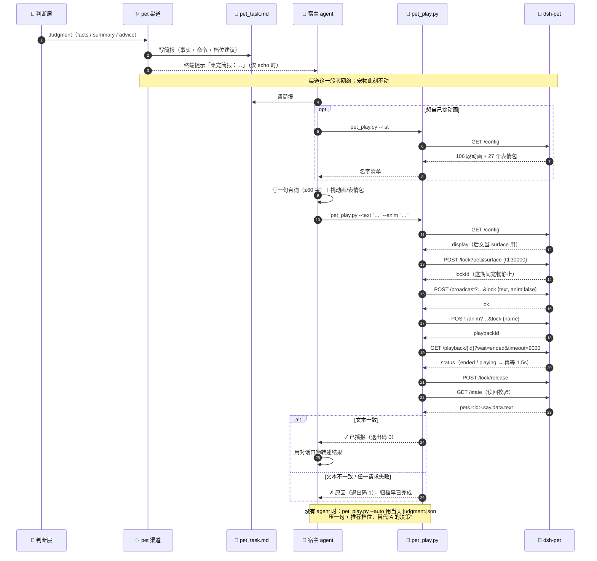
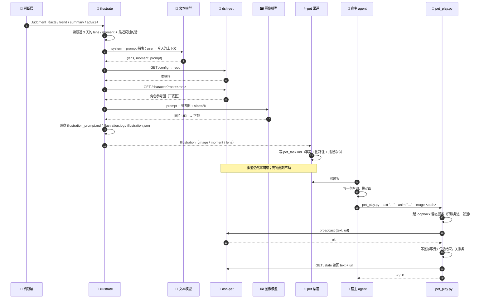

# 桌宠通道架构（v3 播报 / v4 插画）

> 状态：**v3 已实现；v4 已实现（MVP，Ark Seedream）**。
> 本文只讲**怎么实现**：放在哪、怎么调、失败怎么兜、改哪些文件。
> 需求与用户看到什么见 [桌宠播报 feature](feature-pet-channel.md) 与
> [每日插画 feature](feature-pet-illustration.md)；给文本模型的写法见
> [prompt 指南](prompt-pet-illustration.md)。
>
> 关联：[RFC 扩展点](rfc.md#扩展点) ·
> [dsh-pet 对外接口](https://github.com/PC2005-cloud/dsh-pet/blob/main/API.md)

## 1. 范围与边界

本文覆盖渲染阶段的三件事：

| 动作 | 位置 | 做什么 |
|---|---|---|
| `illustrate` | `judge` 之后、渠道之前 | 文本模型写 prompt → 图像模型出图 → 落盘 |
| `pet` 渠道 | `render` 阶段内部 | 写 `pet_task.md` 简报，**零网络** |
| `pet_play.py` | 管线之后，由宿主 agent 调 | 取锁 / 投喂 / 播动画 / 喂图 / 读回 / 释放 |

不在本文范围：`judge` 内部逻辑、`collect`、dsh-pet 自己的实现、角色素材维护。
角色和参考图由 dsh-pet 维护，StepLedger 只取用、不复制。

## 2. 总体位置

```
collect(今天) → settle(昨天) → judge(今天) → illustrate(今天) → render(channels)
                                                               ├── console：report.md
                                                               └── pet：pet_task.md
                                                                     ↓
                                                             宿主 agent + pet_play.py
                                                                     ↓
                                                                  dsh-pet
```

两条不变量：

1. **渠道零网络**：`render/channels/*` 只读 `Judgment` / `RenderContext`，不发请求。
2. **`illustrate` 不是渠道**：它可能花钱、可能失败，放在渠道之前；`--stage render`
   不重复生图。

### 2.1 v3 播报时序



两条阅读重点：**① 分界线在「读简报」**——左边是管线（确定性、无网络），右边是 agent 与脚本；
**② 锁的区间**覆盖投喂到回执结束，释放必须在动画播完之后，否则解冻会把动画顶掉。

### 2.2 v4 插画时序



三个阅读重点：

1. **分界线在 `illustrate` 之后**：文本模型和图像模型都在渠道之前跑完；渠道只拿到成品路径。
2. **`illustrate` 是渲染阶段的一步，不是渠道**：可以 `--stage illustrate` 单独重跑，
   `--stage render` 不会偷偷花钱。
3. **图可以被别的渠道复用**：今天先给 pet；以后 console / IM 要图，直接读同一个产物。

## 3. 分工

| 角色 | 负责 | 不负责 |
|------|------|--------|
| 判断层 | 事实：`summary` / `advice` / 进度 | 语气、动作、画面 |
| `illustrate`（渲染阶段第一步） | 挑瞬间 / 写 prompt / 调图像模型 / 落盘 | 说话、投喂、维护角色素材 |
| 渲染层 `pet` 渠道 | 写 `pet_task.md`（事实 + 插画路径 + 可发挥空间 + 命令），**零网络请求** | 不说台词、不碰宠物、不调模型 |
| 宿主 agent | 读简报，写一句、挑动画/表情包、跑脚本 | 不改简报里的数字、不改已生成的图 |
| `scripts/pet_play.py` | surface 匹配 / 锁 / 投喂 / 点播 / 喂图 / 等回执 / 释放 / 读回 | 不创作内容 |

## 4. 插画：为什么不在渠道里

渠道的契约是「投递」，不是「生产」：

- 渠道可能被重跑（`--stage render`）、可能只开一个、可能失败。把生图放进去，
  重跑一次就多花一次钱，一个渠道挂掉还会连累另一个。
- 图是**共享产物**：以后 console / IM 要图，直接读同一个文件；它不该是 pet 的私货。
- 渠道的测试靠「`urlopen` 零调用」守边界。一调模型，这条断言就废了。

所以 `illustrate` 是 `pipeline.run` 在 `judge` 之后、`_render` 之前的一步；
`render/channels/*` 只读成品，不碰网络。

## 5. 插画的三步

### 5.1 写 prompt

- 读 `docs/prompt-pet-illustration.md` 中 `---` 之前的部分作 system prompt
  （附录 A 只给调用方，不进 prompt）。
- 上下文 = `Judgment`（facts / trend / summary / advice）+ `recent_said` +
  最近 3 天 `illustration.json` 的 `{lens, moment}` + `character`（若配了
  `ILLUSTRATION_CHARACTER`）；**不读原始素材**（隐私、聚焦）。
- 复用 `JUDGE_*` 的 OpenAI 兼容 provider（`response_format=json_object`）。
- 输出 `{lens, moment, prompt}`；JSON 坏了一次就重试一次，再坏就跳过。
- **机械检查**：`prompt` 里出现多于一个金额/金额式数字（比例/头身数不算）、
  列表/表格样式（多行数字、`合计`、`明细`）、账户尾号、商户名，就打回重写一次；
  再犯就跳过——规则写进指南，但最终靠代码拦。

### 5.2 取参考图

- `GET {PET_BASE_URL}/config` 找 `PET_ID` → 条目 key = 素材根；
- `GET /character?root=<root>` 取三视图；404/400 回退 `ILLUSTRATION_REFERENCE`；
- 都没有 → 跳过（不画通用角色）；
- `whisperPrompt` 是行为语气，不是视觉设定，别当角色描述。

### 5.3 出图

```jsonc
POST {ILLUSTRATION_BASE_URL}/images/generations
{
  "model": "doubao-seedream-5.0-flash",
  "prompt": "<文本模型写出的 prompt>",
  "image": ["data:image/png;base64,..."],
  "size": "2K",
  "response_format": "url",
  "watermark": false
}
```

下载 URL → 按 magic bytes 存 `.jpg` / `.png`；写 `illustration.json`。
2K 一张约 16k tokens、10–30 秒；每天最多 1 张，失败不重试超过 1 次。

### 5.4 图里的数字与台词

数字和台词**可以进画面**，但只做点睛，不做信息载体：

- 最多一个关键数（今天花了多少 / 超了多少 / 还剩多少额度 / 目标百分比）
  + 一句短台词（≤12 字），嵌在场景里（小票抬头、便签、日历、招牌）；
- **不做**明细列表、多行金额、表格、图表、四格漫画、多个标签；
- 不写账户尾号、商户名、日期、完整余额；
- 写不清就宁可不写——文字盖住角色，比没有文字更糟。

看画面的人不需要靠图读明细——明细在气泡和报告里，图只负责那一眼。

### 5.5 数据契约（草案）

```python
@dataclass
class Illustration:
    image: Path | None = None
    prompt: str = ""
    moment: str = ""
    lens: str = "moment"
    reason: str = ""          # 没有图时写原因，简报照常
```

- `RenderContext` 增加 `illustration: Illustration | None`，由 `illustrate` 填好；
  渠道拿到的是路径和一句话，不是模型调用。
- `--stage render` 不跑 `illustrate`，只读已有的 `illustration.json` 填进 ctx；
  如果这轮触发了重算，旧图可能过期，**不挂图**，简报提示补 `--stage illustrate`。
- `PipelineResult.illustration` 带上它，`--json` 能读到；缺图时 `reason` 写原因。

## 6. 播报：简报与脚本

### 6.1 简报格式

`archive/YYYY-MM-DD/pet_task.md`，五块：

```markdown
## 今天的事实（可以复述，别改数字）
- 总结 / 建议 / 进度 / 素材份数（降级时加一行警告）

## 插画（有就带上，没有就明说）
- 图：archive/2026-11-06/illustration.jpg（3:4）
- 这一幕：夜里看到外卖账单，眉毛垮下来的那一秒
- 没有插画时：今天没有插画（原因：…），只播文字

## 你来定（这才是这一步的价值）
- **今天的口吻**：按日期在 7 种里轮换
- 一句话 ≤60 字、一段动画、可选表情包（与插画二选一）、可选时长
- **最近说过**：自动列出前几天的台词，重复就没意思了

## 播
python scripts/pet_play.py --text "…" --anim "…" --image archive/2026-11-06/illustration.jpg
python scripts/pet_play.py --list

目标：http://127.0.0.1:<port>/dsh-pet-7340 · 宠物：main
```

两条边界：**插画与表情包二选一**——有 `--image` 时不要再给 `--meme`
（dsh-pet 的 `image` / `url` 互斥，脚本会拒）；**台词仍然独立创作**——不要照抄 `moment`。

`ctx.echo` 为真时渠道在终端打一行
`桌宠简报：<path>（读它，用 scripts/pet_play.py 播报）`。

### 6.2 `pet_play.py` 的请求序列

| 步骤 | 请求 | 作用 |
|------|------|------|
| 0 | `GET /config` | 取这只宠物的 `display`，作为后面的 `surface` |
| 1 | `POST /lock?pet&surface` `{ttl:30000}` | 独占，宠物自己的碎碎念/漫游让路 |
| 1b | 起 `http://127.0.0.1:<临时端口>/<随机路径>` | 只有 `--image` 时：只服务这一张图；图被取走或气泡到点就关 |
| 2 | `POST /broadcast?…&lock` `{text, anim, image?/url?, duration?}` | 写气泡；带插画时传 `url` |
| 3 | `POST /anim?…&lock` `{name}` | 只有指定动画时才点播 |
| 4 | `GET /playback/{id}?wait=ended&timeout=9000` | 等播完（HTTP 超时放宽到 10s） |
| 5 | `POST /lock/release?…` `{lockId}` | 释放；成败都要放 |
| 6 | `GET /state` | **读回**：`say.data.text` 必须等于刚说的话；带图时再看 `say.data.url`，对不上只算「图未确认」，文字仍算成功 |

### 6.3 `--image` 的显示机制

dsh-pet 的 `/broadcast` 只收两种配图：池内 `image` 名，或 `url`（只放行 http/https）。
生成图是本地文件，所以脚本：

1. 起一个只监听 `127.0.0.1` 的临时静态服务，随机路径只服务这一张图；
2. `broadcast {text, url}`；
3. 等图被取走（或气泡时长到）→ 关服务；
4. 读回 `/state`：`say.data.text` 和 `say.data.url` 都要对上；
5. 图服务起不来 / `url` 被拒 → 退回纯文字播报，退出码仍为 0（图是增强，不是前提）。

不把图写进 dsh-pet 的表情包目录：那是它的素材，不是我们的缓存；
也不把本地路径直接塞给 `url`（`file:` 被拒，桌面端也不该读任意文件）。

## 7. 改动范围

### 7.1 v3 已落地（就这些）

| 文件 | 改动 |
|------|------|
| `render/channels/pet.py` | **新增**：`build_brief` + `PetChannel`（只写简报）+ `PetClient`（机械层） |
| `scripts/pet_play.py` | **新增**：agent 用的播报命令，含 `--list` / `--auto` |
| `pipeline._render` | 渠道字典加一行 |
| `shared/config.py` | `pet_base_url` / `pet_id` / `pet_anim_tiers` |
| `.env.example` | 三行 fake 占位 |
| `tests/test_pet_channel.py` | **新增**，25 个用例 |
| 文档 | feature + architecture + RFC 一行 + working.md |
| 归档新增 | `archive/<日期>/pet_said.md`（播报记录，供次日去重；由 `pet_play.py` 追加） |

### 7.2 v4 增量（插画）

| 文件 | 改动 |
|------|------|
| `render/illustration.py` | **新增**：写 prompt（复用 `JUDGE_*` provider）+ 取参考图 + 调图像模型 + 落盘 |
| `pipeline.run` | `judge` 之后、`_render` 之前调 `illustrate`；`--stage` 增加 `illustrate` |
| `shared/types.py` | `Illustration`；`RenderContext.illustration`；`PipelineResult.illustration` |
| `shared/config.py` | `ILLUSTRATION_*` / `PET_CHARACTER_ROOT` |
| `render/channels/pet.py` | 简报加「插画」一段；有图给 `--image` 命令，没图写原因 |
| `scripts/pet_play.py` | `--image <path>`：loopback 静态服务 + `url` 投喂 + 读回 `url` |
| `docs/prompt-pet-illustration.md` | **新增**：给文本模型的运行时指南 |
| `tests/test_illustration.py` | **新增**：prompt 解析 / 缺 key 跳过 / 参考图回退 / magic bytes / 失败不拖垮 |
| `tests/test_pet_channel.py` | 加 `--image` 的 serve / broadcast / 读回 / 服务起不来用例 |
| `.env.example` | 插画配置的 fake 占位 |

**明确不动**：`_fallback_render`、`RenderResult`、`BaseChannel` 接口、`console`、judge 内部逻辑、
collect、归档布局。`RENDER_CHANNELS` 不加 `pet` 时零网络、零新文件；不配 `ILLUSTRATION_API_KEY`
时插画整段跳过。

## 8. 配置

| 键 | 默认 | 说明 |
|----|------|------|
| `RENDER_CHANNELS` | `console` | 加 `pet` 才写简报 |
| `PET_BASE_URL` | 空 | 如 `http://127.0.0.1:3000/dsh-pet-7340`；空 = 不启用。只接受 loopback |
| `PET_ID` | `main` | 播报哪一只 |
| `PET_ANIM_TIERS` | 空 | 只影响简报里的档位建议和 `--auto`；agent 手播时可以无视 |
| `ILLUSTRATION_ENABLED` | `auto` | `auto` = 有 key 且开了 `pet` 才开；`off` = 强制关 |
| `ILLUSTRATION_API_KEY` | 空 | 生图 key；空 = 不生成插画 |
| `ILLUSTRATION_BASE_URL` | Agent Plan `/api/plan/v3` | 按量计费改 `/api/v3` |
| `ILLUSTRATION_MODEL` | `doubao-seedream-5.0-flash` | 点号；写错会 404 |
| `ILLUSTRATION_SIZE` | `2K` | 2K + 3:4（实测 1776×2368） |
| `ILLUSTRATION_QUALITY` | `medium` | 只对支持的 provider 生效；Ark 用 flash 表达中档 |
| `ILLUSTRATION_REFERENCE` | 空 | 本地参考图兜底；`/character` 不可用时用 |
| `ILLUSTRATION_CHARACTER` | 空 | 覆盖默认角色卡（视觉设定） |
| `PET_CHARACTER_ROOT` | 空 | 覆盖素材根；空 = 从 `/config` 按 `PET_ID` 找 |

`.env.example` 只放 fake 占位，真实端口与 key 留在 `.env`。

## 9. 产物与归档

| 文件 | 内容 | 谁写 |
|---|---|---|
| `archive/<日期>/illustration_prompt.md` | 这次用的上下文 + `{lens, moment, prompt}`（daily prompt，必须归档） | `illustrate` |
| `archive/<日期>/illustration.jpg` | 生成的图（JPEG/PNG 按 magic bytes） | `illustrate` |
| `archive/<日期>/illustration.json` | 元数据：model / size / lens / moment / reference / usage / 耗时 / 文件 | `illustrate` |
| `archive/<日期>/pet_task.md` | 简报：事实 + 图路径 + `--image` 命令 | `pet` 渠道 |
| `archive/<日期>/pet_said.md` | 播报记录（含是否带图） | `pet_play.py` |

`illustration.json` 字段（草案）：

```jsonc
{
  "date": "2026-11-06",
  "lens": "moment",
  "moment": "夜里看到外卖账单，眉毛垮下来的那一秒",
  "prompt": "Q版蓝发鲸鱼娘女仆……",
  "image": "illustration.jpg",
  "model": "doubao-seedream-5.0-flash",
  "size": "1776x2368",
  "reference": "character",        // character | local | none
  "usage": {"total_tokens": 16428},
  "elapsed_ms": 18400,
  "created_at": "2026-11-06T21:03:12+08:00"
}
```

## 10. 失败与降级

一条铁律：**播报/插画失败绝不拖垮归档。**

| 场景 | 行为 |
|------|------|
| 未配 `PET_BASE_URL` / 非本机 | 渠道跳过，`render.log` 一行，不写简报 |
| 当天没有素材 | 静默跳过（不写简报、不播报），归档照常 |
| 没配 `ILLUSTRATION_API_KEY` / `ILLUSTRATION_ENABLED=off` | 不生成插画；简报写「今天没有插画」，文字照播 |
| 没参考图（`/character` 404 且没 `ILLUSTRATION_REFERENCE`） | 不画；不用通用角色冒充；简报写原因 |
| 文本模型是 stub / 判断降级 | 不画；没有可信的上下文 |
| 文本模型输出不是 JSON | 重试 1 次（只提醒「只输出 JSON」）；仍失败 → 跳过 |
| `prompt` 里出现明细/多行金额/URL/商户名/尾号 | 机械拦下、打回重写 1 次；再犯 → 跳过 |
| 图像 API 4xx / 5xx / 超时 | 跳过；`render.log` 记原因；不重试超过 1 次 |
| 图片下载失败 | 跳过；已生成的 URL 不落盘 |
| dsh-pet 没运行 | 管线正常结束；agent 跑脚本时退出码 2/1 并给出原因 |
| 宠物 `display=none` / id 不存在 | 脚本报「找不到宠物或它没有显示」 |
| 被别的插件占用 | 脚本报「取锁失败或被占用」，不重试 |
| 投喂断网 | 仍然释放锁，退出码 1 |
| 读回不一致 | 文字对不上 → 判失败（`ok` 只是受理，不代表显示成功）；带图 `url` 对不上 → 文字仍算成功，图记「未确认」 |
| 配图 `url` 被拒 | 自动改成纯文字再投喂一次；仍失败才判失败 |
| 图服务起不来 / 文件不存在 | 纯文字播报，退出码 0 |
| `--stage render` | 不重新生图；缺图按「今天没有插画」写简报 |
| `--stage render` 触发了重算 | 旧图可能过期；不挂图，简报提示补 `--stage illustrate` |
| 没人跑脚本（纯 cron） | 宠物不说话；要么 `--auto`，要么接受静默。插画可以照常生成，但没人播 |

## 11. 测试

### 11.1 播报（`tests/test_pet_channel.py`，33 个）

| 覆盖 | 用例 |
|------|------|
| 文案 / 档位 | `test_bubble_text_*`、`test_tiers_from`、`test_pick_animation_tiers` |
| 简报 | `test_brief_carries_facts_and_command`、`test_brief_warns_on_degraded`、`test_brief_has_no_sample_line_and_rotates_style`、`test_brief_lists_recent_lines`、`test_record_said_appends`、`test_brief_includes_illustration`、`test_brief_says_no_illustration`、`test_recent_said_keeps_todays_line_across_days` |
| 渲染层零请求 | `test_channel_writes_task_and_makes_no_requests`、`test_channel_skips_without_base_url`、`test_channel_rejects_non_loopback` |
| 机械层 | `test_catalog_lists_animations_and_memes`、`test_play_sequence`、`test_play_without_animation_uses_talking_anim`、`test_play_with_meme_and_duration` |
| 失败路径 | `test_play_readback_mismatch_is_failure`、`test_play_locked_is_failure`、`test_play_offline_still_releases`、`test_play_empty_text_is_rejected` |
| 带图 / 图服务 | `test_play_with_image_serves_and_reads_back`、`test_play_missing_image_falls_back_to_text`、`test_play_url_rejected_falls_back_to_text`、`test_play_rejects_meme_and_image`、`test_local_image_server_404` |
| 时序回归 | `test_playback_http_timeout_outlives_long_poll` |
| 管线集成 | `test_pipeline_pet_writes_brief_only`、`test_pipeline_without_pet_is_offline` |

### 11.2 插画（`tests/test_illustration.py`，14 个）

| 覆盖 | 实际用例 |
|------|------|
| 指南 / prompt | `test_load_guide_strips_appendix`、`test_load_guide_missing_is_error`、`test_parse_prompt_plan_accepts_fenced_json`、`test_parse_prompt_plan_rejects_empty_prompt` |
| 机械拦报表 | `test_looks_like_report_allows_one_number`、`test_looks_like_report_rejects_amount_list` |
| 参考图 | `test_reference_falls_back_to_local`、`test_reference_missing_is_skipped` |
| 生图 / 落盘 | `test_run_writes_artifacts`、`test_load_existing_and_stale`、`test_local_image_server_serves_one_file` |
| 降级 | `test_run_without_key_skips`、`test_run_skips_degraded`、`test_run_does_not_call_network_without_key` |

## 12. 实测记录（2026-10-30，dsh-pet 0.3.8）

| 动作 | 观察 |
|------|------|
| `POST /lock` | `{"ok":true,"lockId":"lk-…"}`，11ms |
| `POST /broadcast` | `say.data.text` 立刻变成投喂文本；`anim:true` 时不传图像也能配表情包 |
| `POST /anim` | `surface=desktop` 时 `收红包`/`照镜子` 均 `status: playing` 满 10 秒 |
| 同一动画用 `surface=any` | 0.5 秒后 `status: cancelled`，`reason: superseded` |
| `wait=ended` 的 `timeout=15000` | `bad-request: invalid timeout (expect 0..10000)` |
| 长轮询的 HTTP 超时 | 必须 ≥ `wait` 时长；统一 1.5s 会让 9s 的 `wait` 必然先超时 |
| token 消耗 | `/broadcast` 零消耗；`/whisper`、`/chat` 才会 |

### 2026-11-06 每日插画（Ark Seedream + 真实 dsh-pet）

| 项 | 观察 |
|------|------|
| 参考图 | 本地 `main-character.png`（运行版 0.4.4 还没有 `/character`，走回退） |
| 文本 prompt | `deepseek-flash`，6,207 tokens（命中 3,840 缓存） |
| 图 | 1776×2368 JPEG，16,428 tokens，29.4 秒 |
| 图内文字 | 只有一个「81」+「收一收」，没有明细/表格/报表 |
| 带图播报 | `pet_play --image` 对真实 dsh-pet 成功；`/state` 读回 text + url，退出码 0 |

## 13. 风险与边界

- **依赖 agent**：没有 agent 读简报，宠物就不说话；cron 用 `--auto`（确定性台词，不烧 token）
- **台词质量无自动校验**：脚本只管长度提示，管不了「说得像不像人」——这是 agent 的活
- **占用锁**：取锁期间用户拖不动宠物，所以 TTL 30s、播完立刻放
- **阻塞**：指定动画时脚本会等到播完（≤11 秒）；不指定动画时只要 1 秒；带图时多等图被取走
- **端口不稳定**：路由挂在 DSH 自己的 Web 服务上，只走配置，绝不写死
- **素材授权**：dsh-pet 的动画素材是 CC BY-NC-SA 4.0、禁止商用；这里只调 API，不再分发
- **角色一致性靠参考图**：`/character` 没有时宁可不出图；不要用「通用人鱼」冒充
- **生图有随机性**：同一 prompt 两次不会完全一样；验收看「角色/情绪/单场景」，不看像素
- **成本与延迟**：2K 一张约 16k tokens、10–30 秒；每天 1 张，失败不反复重试
- **旧版 dsh-pet**：0.4.4 / 0.4.5 没有 `/character`；要么升级，要么配本地参考图

## 14. 未决问题（技术）

1. `--auto` 要不要也交给模型润色？现在坚持确定性（不烧 token、可预测）
2. 简报要不要带上前几天的判断，让 agent 说得更有连续性
3. 多宠物：`PET_ID` 单选够用，还是轮流说
4. 播报失败要不要弹系统通知（现在只给退出码）
5. 谁来写插画 prompt：管线调一次 `JUDGE_*`（cron 也出图、可版本化）还是宿主 agent 直接写
   （省一次调用、但没 agent 就没图）；现在选前者
6. 插画要不要给 agent 留 `--moment` / `--prompt` 的覆盖入口（特殊日子手工改画面）
7. 图要不要也给 console / IM（共享产物，先只给 pet）
8. `--stage render` 发现缺图时，要不要自动补一次（现在坚持不自动花钱）
9. prompt 指南放 `docs/` 还是打进包（安装形态不同，路径要定）
