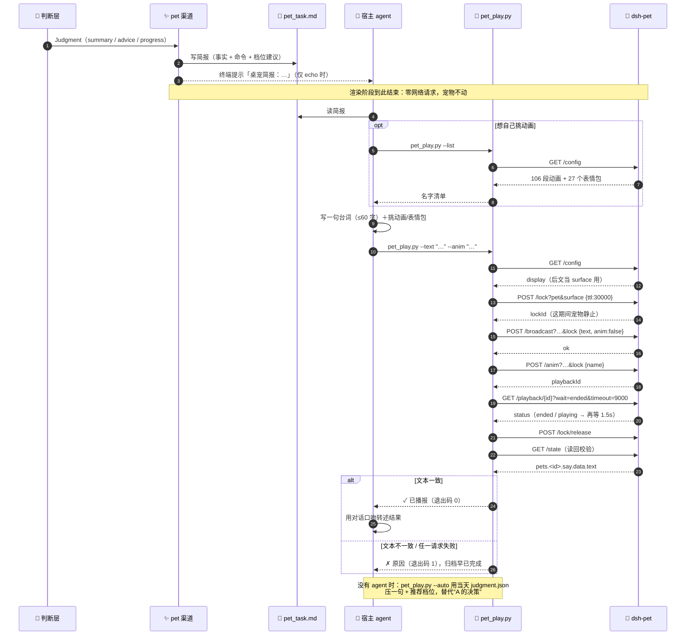

# Feature：桌宠播报（agent 驱动）

> 状态：**v3 已实现**。判断层给事实 → 渲染层出简报 → **agent 决定怎么说** → 脚本执行。
> 关联：[RFC 扩展点](rfc.md#扩展点) · [dsh-pet 对外接口](https://github.com/PC2005-cloud/dsh-pet/blob/main/API.md)
> v2 的实测记录（`surface` / `timeout` / 长轮询）仍然有效，见下方。

## 一句话

判断层把今天说完，**怎么说、播什么，交给 agent**；渲染层只产出一份简报，
`scripts/pet_play.py` 把 agent 的话安全送进桌宠。

## 为什么不是「管线直接播」

v2 试过让渠道自己发 HTTP、取 summary 首句、按进度套五档动画。能跑，但**死板**：

| | 管线直接播（v2） | agent 播（v3） |
|---|---|---|
| 台词 | `summary` 首句，天天一个模子 | agent 自己写：可以安慰、催一句、吐槽、点名某个动作 |
| 动画 | 按进度固定五档 | 106 段任选，可以按**情绪**挑而不是按数字 |
| 配图 | 没有 | 27 个表情包可选 |
| 上下文 | 只有 `Judgment` | 还能看到素材、历史、今天星期几、你昨天说过什么 |
| 语气 | 模板 | 会变，不会每天都是同一句腔调 |

一句话：**随机性和语气不该由模板决定，该由判断「今天该用什么口气」的那个角色决定。**

## 用户看到什么

管线跑完，`archive/2026-10-30/pet_task.md` 落一份简报；agent 读完，自己写一句：

> 工资到账先扣一小份藏起来，剩下的花着才不慌。

配「收红包」这段动画（不是按进度算出来的「数金皱眉」）——因为今天该庆祝，不该皱眉。

## 分工

| 角色 | 负责 | 不负责 |
|------|------|--------|
| 判断层 | 事实：`summary` / `advice` / 进度 | 语气、动作 |
| 渲染层 `pet` 渠道 | 写 `pet_task.md`（事实 + 可发挥空间 + 命令），**零网络请求** | 不说台词、不碰宠物 |
| 宿主 agent | 读简报，写一句、挑动画/表情包、跑脚本 | 不改简报里的数字 |
| `scripts/pet_play.py` | surface 匹配 / 锁 / 投喂 / 点播 / 等回执 / 释放 / 读回 | 不创作内容 |

## 时序



两条阅读重点：**① 分界线在「读简报」**——左边是管线（确定性、无网络），右边是 agent 与脚本；
**② 锁的区间**覆盖投喂到回执结束，释放必须在动画播完之后，否则解冻会把动画顶掉。

## 改动范围（就这些）

| 文件 | 改动 |
|------|------|
| `render/channels/pet.py` | **新增**：`build_brief` + `PetChannel`（只写简报）+ `PetClient`（机械层） |
| `scripts/pet_play.py` | **新增**：agent 用的播报命令，含 `--list` / `--auto` |
| `pipeline._render` | 渠道字典加一行 |
| `shared/config.py` | `pet_base_url` / `pet_id` / `pet_anim_tiers` |
| `.env.example` | 三行 fake 占位 |
| `tests/test_pet_channel.py` | **新增**，20 个用例 |
| 文档 | 本文件 + RFC 一行 + working.md（**不动 `skills/StepLedger.md`**：那是全局契约，不塞渠道细节） |
| 归档新增 | `archive/<日期>/pet_said.md`（播报记录，供次日去重；由 `pet_play.py` 追加） |

**明确不动**：`_fallback_render`、`RenderResult`、`BaseChannel` 接口、`console`、judge、collect、
归档布局。`RENDER_CHANNELS` 不加 `pet` 时零网络、零新文件。

## 配置

| 键 | 默认 | 说明 |
|----|------|------|
| `RENDER_CHANNELS` | `console` | 加 `pet` 才写简报 |
| `PET_BASE_URL` | 空 | 如 `http://127.0.0.1:3000/dsh-pet-7340`；空 = 不启用。只接受 loopback |
| `PET_ID` | `main` | 播报哪一只 |
| `PET_ANIM_TIERS` | 空 | 只影响**简报里的档位建议**和 `--auto`；agent 手播时可以无视它 |

`.env.example` 只放 fake 占位，真实端口留在 `.env`。

## 第一段：渲染层只写简报

- 未配 `PET_BASE_URL` → 跳过，不写文件、不发请求
- 非本机地址 → 跳过（账本内容不出本机）
- **当天没有素材** → 静默跳过，不写简报、不播报（无人值守时不打扰）
- 其余情况写 `archive/YYYY-MM-DD/pet_task.md`，内容固定四块：

```markdown
## 今天的事实（可以复述，别改数字）
- 总结 / 建议 / 进度 / 素材份数（降级时加一行警告）

## 你来定（这才是这一步的价值）
- **今天的口吻**：按日期在 7 种里轮换（具体动作 / 反问 / 自嘲 / 比喻 / 宣布 / 关心 / 吐槽）
- 一句话 ≤60 字、一段动画、可选配图、可选时长
- **最近说过**：自动列出前几天的台词，重复就没意思了

## 播
python scripts/pet_play.py --text "…" --anim "…"
python scripts/pet_play.py --list

目标：http://127.0.0.1:<port>/dsh-pet-7340 · 宠物：main
```

**agent 怎么发现它**：不靠全局文档。`ctx.echo` 为真时渠道在终端打一行
`桌宠简报：<path>（读它，用 scripts/pet_play.py 播报）`；简报正文第一段也自称是交给 agent 的活。
`skills/StepLedger.md` 是全局契约，**不改**——没装 dsh-pet 的人不该在 skill 里看到桌宠步骤。

简报**不写台词**，只给素材和出口。推荐档位（`p<25` → 袋空如洗 … `p≥100` → 钱袋满溢）是建议，不是规定。

## 第二段：agent 播报

```bash
# 看这只宠物能播什么（106 段动画 + 27 个表情包）
python scripts/pet_play.py --list

# 播一句（动画可选，不给就用宠物自己的碎碎念动画）
python scripts/pet_play.py --text "工资到账先扣一小份藏起来" --anim "收红包"

# 配图 / 控制时长
python scripts/pet_play.py --text "又超了啊" --meme "要不直接骂他" --duration 8000

# 无人值守：用当天 judgment.json 压一句（cron / 没有 agent 时）
python scripts/pet_play.py --auto
```

脚本内部仍然是那六步，**agent 不需要知道**：

| 步骤 | 请求 | 作用 |
|------|------|------|
| 0 | `GET /config` | 取这只宠物的 `display`，作为后面的 `surface` |
| 1 | `POST /lock?pet&surface` `{ttl:30000}` | 独占，宠物自己的碎碎念/漫游让路 |
| 2 | `POST /broadcast?…&lock` `{text, anim, image?, duration?}` | 写气泡；给了动画就 `anim:false`，没给就 `anim:true` 用它自己的说话动画 |
| 3 | `POST /anim?…&lock` `{name}` | 只有指定动画时才点播 |
| 4 | `GET /playback/{id}?wait=ended&timeout=9000` | 等播完（HTTP 超时放宽到 10s） |
| 5 | `POST /lock/release?…` `{lockId}` | 释放；成败都要放 |
| 6 | `GET /state` | **读回**：`pets.<id>.say.data.text` 必须等于刚说的话，否则判失败 |

台词的三条硬约束**写在简报里**，随简报一起交给 agent：**≤60 字**、**不改数字**、**不复述总结**。

另外两处防「每天同一句」：**简报里的播报命令故意不给示例台词**（照抄示例就是固定文案）；
每次播报会把这句话追加到 `archive/<日期>/pet_said.md`，次日简报的「最近说过」会列出来。

## 实测记录（2026-10-30，dsh-pet 0.3.8）

| 动作 | 观察 |
|------|------|
| `POST /lock` | `{"ok":true,"lockId":"lk-…"}`，11ms |
| `POST /broadcast` | `say.data.text` 立刻变成投喂文本；`anim:true` 时不传图像也能配表情包 |
| `POST /anim` | `surface=desktop` 时 `收红包`/`照镜子` 均 `status: playing` 满 10 秒 |
| 同一动画用 `surface=any` | 0.5 秒后 `status: cancelled`，`reason: superseded` |
| `wait=ended` 的 `timeout=15000` | `bad-request: invalid timeout (expect 0..10000)` |
| 长轮询的 HTTP 超时 | 必须 ≥ `wait` 时长；统一 1.5s 会让 9s 的 `wait` 必然先超时 |
| token 消耗 | `/broadcast` 零消耗；`/whisper`、`/chat` 才会 |

## 失败与降级

一条铁律：**播报失败绝不拖垮归档**。

| 场景 | 行为 |
|------|------|
| 未配 `PET_BASE_URL` / 非本机 | 渠道跳过，`render.log` 一行，不写简报 |
| 当天没有素材 | 静默跳过（不写简报、不播报），归档照常 |
| dsh-pet 没运行 | 管线正常结束；agent 跑脚本时退出码 2/1 并给出原因 |
| 宠物 `display=none` / id 不存在 | 脚本报「找不到宠物或它没有显示」 |
| 被别的插件占用 | 脚本报「取锁失败或被占用」，不重试 |
| 投喂断网 | 仍然释放锁，退出码 1 |
| 读回不一致 | 判失败（`ok` 只是受理，不代表显示成功） |
| 没人跑脚本（纯 cron） | 宠物不说话；要么 `--auto`，要么接受静默 |

## 验收标准

1. **零配置零影响**：不配 `PET_BASE_URL` 时，产物与现状一致、零网络、无 `pet_task.md`
2. **渲染层不碰宠物**：配了地址后管线**只写简报**，测试断言 `urlopen` 零调用
3. **agent 真的能播**：`pet_play.py` 对真实 dsh-pet 跑一次，`/state` 的 `say.text` 与发出的文本一致，
   `anim.name` 等于指定动画，`lock.locked == false`
4. **读回才算成功**：`/broadcast` 回 `ok` 但 `/state` 对不上时，脚本退出码 1
5. **坏配置不炸**：非本机地址、未配置、宠物不存在，全部只影响播报
6. **不烧 token**：整条路径不调用任何生成端点
7. **渠道独立**：`RENDER_CHANNELS=pet` 单跑成立，不读 `report.md`

## 测试（`tests/test_pet_channel.py`，24 个）

| 覆盖 | 用例 |
|------|------|
| 文案 / 档位 | `test_bubble_text_*`、`test_tiers_from`、`test_pick_animation_tiers` |
| 简报 | `test_brief_carries_facts_and_command`、`test_brief_warns_on_degraded`、`test_brief_has_no_sample_line_and_rotates_style`、`test_brief_lists_recent_lines`、`test_record_said_appends` |
| 渲染层零请求 | `test_channel_writes_task_and_makes_no_requests`、`test_channel_skips_without_base_url`、`test_channel_rejects_non_loopback` |
| 机械层 | `test_catalog_lists_animations_and_memes`、`test_play_sequence`、`test_play_without_animation_uses_talking_anim`、`test_play_with_meme_and_duration` |
| 失败路径 | `test_play_readback_mismatch_is_failure`、`test_play_locked_is_failure`、`test_play_offline_still_releases`、`test_play_empty_text_is_rejected` |
| 时序回归 | `test_playback_http_timeout_outlives_long_poll` |
| 管线集成 | `test_pipeline_pet_writes_brief_only`、`test_pipeline_without_pet_is_offline` |

## 风险与边界

- **依赖 agent**：没有 agent 读简报，宠物就不说话；cron 用 `--auto`（确定性台词，不烧 token）
- **台词质量无自动校验**：脚本只管长度提示，管不了「说得像不像人」——这是 agent 的活
- **占用锁**：取锁期间用户拖不动宠物，所以 TTL 30s、播完立刻放
- **阻塞**：指定动画时脚本会等到播完（≤11 秒）；不指定动画时只要 1 秒
- **端口不稳定**：路由挂在 DSH 自己的 Web 服务上，只走配置，绝不写死
- **素材授权**：dsh-pet 的动画素材是 CC BY-NC-SA 4.0、禁止商用；这里只调 API，不再分发

## 未决问题

1. `--auto` 要不要也交给模型润色？现在坚持确定性（不烧 token、可预测）
2. 简报要不要带上前几天的判断，让 agent 说得更有连续性
3. 多宠物：`PET_ID` 单选够用，还是轮流说
4. 播报失败要不要弹系统通知（现在只给退出码）
