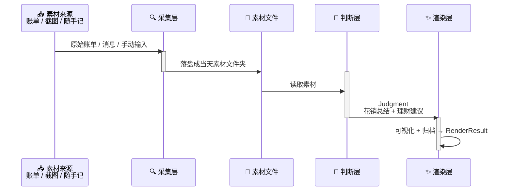

# StepLedger — 架构设计文档（RFC）

描述当前架构、边界、核心设计决策。被否决的备选方案见文末附录。

## 总体架构



管线：采集只负责收，判断只负责说，渲染只负责给人看。层间以文件为界——采集层的产物是素材文件夹，判断层的输入就是它。

设计取向是**定性，不定量**：架构里不放精确对账、预算阈值、分类报表。判断层允许模糊、允许主观，唯一硬要求是"有温度、说人话、仅供参考"。

## 调度归属：Skill 定流程，Agent 定时间

skill 不会自己定时，它只能被调用。所以时间这件事必须交给宿主：

| 职责 | 归属 |
|------|------|
| 知道"每天该做什么" | 本 skill（流程、口味、归档约定） |
| 决定"什么时候做" | 宿主 agent 的定时 / 心跳能力 |
| 无常驻 agent 时兜底 | `scripts/daily_run.py` + 系统 cron（可选） |

skill 只表达一句话："如果宿主有定时能力，请每天在用户偏好的时间调用我一次。"具体时间由宿主决定，本仓库不假设、也不实现调度器。

由此得到三条实现约束：

1. **幂等** — 同一天被调用多次不能产生重复或错乱归档，按 `YYYY-MM-DD` 目录覆盖/追加
2. **可续跑** — agent 可能中途被打断，任一层单独重跑都应可用
3. **两入口同一产物** — agent 调用与 cron 调用必须走同一条管线，不写两套逻辑

### 长期状态放哪

目标、当前存款、偏好这类跨天状态，不放数据库，放 `materials/profile.md`。文件是单一事实源：agent 模式读它，cron 模式也读它。能用 agent 自己的记忆就用记忆，需要精确复现的才落文件。

## 模块结构

```
src/step_ledger/
├── pipeline.py       # 管线编排
├── collect/          # 层 1: 采集（只落盘，不解读）
│   └── adapters/     # 素材来源适配器
├── judge/            # 层 2: 判断（给总结与建议）
│   └── providers/    # AI Provider 适配层
├── render/           # 层 3: 渲染（可视化 + 归档）
│   └── channels/     # 渲染渠道
└── shared/           # 跨层共享（类型 + 配置 + 路径）
```

### 各层职责

| 层 | 职责 | 输入 | 输出 |
|----|------|------|------|
| `collect` | 把各方素材收拢成文件 | 外部源 / 手动输入 | 素材文件夹 `materials/YYYY-MM-DD/` |
| `judge` | 读素材，产出定性总结与建议 | 素材文件夹 | `Judgment`（花销总结 + 理财建议） |
| `render` | 把 `Judgment` 可视化并归档 | `Judgment` | 渲染产物（文本/图片/网页）+ 归档路径 |
| `pipeline` | 顺序编排各层 | 配置 | `PipelineResult` |

### 层间契约

- **collect → judge**：文件系统。素材目录存在且至少有一个可读文件
- **judge → render**：`Judgment` 数据类型，`summary` 与 `advice` 均非空
- **render → 用户**：产物落盘到 `archive/YYYY-MM-DD/`，或直接输出到终端

### 扩展点

- **素材来源**：继承 `BaseAdapter`，实现 `collect() -> Path`（返回当天素材目录）
- **AI Provider**：继承 `BaseProvider`，实现 `judge(materials_dir: Path) -> Judgment`
- **渲染渠道**：继承 `BaseChannel`，实现 `render(judgment: Judgment) -> Path | str`

## 当前实现状态

- [x] 项目脚手架（目录结构、文档骨架、环境配置）
- [x] 类型定义（`shared/types.py`：`Judgment`、`CollectResult`、`RenderResult`、`PipelineResult`）
- [x] 配置模块（`shared/config.py` + 素材/归档路径约定）
- [x] `materials/profile.md` 约定（目标 / 存款 / 偏好）与读取逻辑
- [x] 素材来源适配器（手动：一段文字 / 一个文件 / 一个目录；素材夹：快捷指令写入的目录按日期只收当天）
- [x] Stub 判断层（不调模型，返回固定语气模板）
- [x] 控制台渲染渠道（`report.md` + `milestones.md` + 终端直显）
- [x] DeepSeek Harness 桌宠渲染渠道（`dsh-pet`：`dsh_prompt.md` + `pet.md` 提示词与复盘产出，详见 `docs/dsh_pet_feature.md`）
- [x] 管线编排（`pipeline.run`，各层可单独重跑）
- [x] cron 入口脚本（`scripts/daily_run.py`）
- [x] 真实 AI Provider（OpenAI 兼容，失败自动降级到 stub）
- [x] 测试（冒烟 / 契约 / 隐私扫描）

### 实现备注

- 入口：`scripts/daily_run.py`（cron 兜底）、`python -m step_ledger`、`step-ledger`（安装后）
- 分阶段：`--stage collect|judge|render`，用于补投素材与断点续跑
- 自动素材夹：`COLLECT_SOURCE_DIRS`（逗号分隔，可指向 iCloud 等被快捷指令写入的目录）；
  `--source` 可临时覆盖。文件归属日期优先取文件名里的 `20261028` / `2026-10-28`，没有才看修改时间；
  同名源文件按原文件名覆盖成当天最新快照（源文件当天追加不会变成多份素材）
- `judgment.meta.progress` 记录当天 target / savings / percent，`milestones.md` 从历史
  `judgment.json` 里汇总进度
- 真实 provider 只需 `JUDGE_PROVIDER=openai` + `JUDGE_API_KEY`，其余走 `.env` 默认值
- `judgment.json` 的 `meta.usage` 记录 token 用量
- 存款来源：`materials/profile.md` 优先；没填时用判断结果里的 `meta.balance`（模型从素材读出，
  读不到就是 `null`）兜底，`Profile.savings_from_materials` 标记并在报告里注明，不写回档案

## 未决问题

1. 素材格式：当前只解析文本类（`.md` / `.txt` / `.csv` / `.json`），图片 OCR 未做
2. 图形化渲染：先做终端文本 + markdown，HTML / 图片渠道待补
3. 素材保留策略（只留最近 N 天 vs 永久）

## 附录：Alternatives Considered & Why

| 决策点 | 选择 | 被否决方案 | 原因 |
|--------|------|-----------|------|
| 语言 | Python | TypeScript | agent skill 场景下脚本依赖轻，Python 生态更成熟 |
| 架构 | 分层管线 | 单体脚本 | 各层职责差异大，需独立替换/测试 |
| 层间通信 | 素材文件夹 + 轻量 dataclass | 全程强类型内存对象 | 素材天然异构、来源不固定，落盘更好扩展也能回放 |
| 解读风格 | 定性 + 有温度 | 精确记账 / 预算管控 | 精确对账成本高、体验冷，用户坚持不下来 |
| 适配器模式 | 基类继承 | 硬编码 if-else | 素材来源/渲染渠道会持续增加 |
