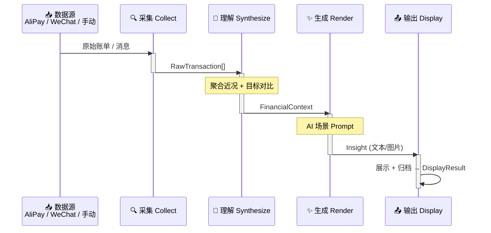

# StepLedger — 架构设计文档（RFC）

描述当前架构、边界、核心设计决策。被否决的备选方案见文末附录。

## 总体架构



四阶段管线，每阶段职责单一、可独立替换。阶段间通过明确的数据类型连接。

## 模块结构

```
src/step_ledger/
├── pipeline.py       # 管线编排
├── collect/          # 阶段 1: 采集
│   └── adapters/     # 数据源适配器
├── synthesize/       # 阶段 2: 理解
├── render/           # 阶段 3: 生成
│   └── providers/    # AI Provider 适配层
├── display/          # 阶段 4: 输出
│   └── channels/     # 输出渠道
└── shared/           # 跨模块共享（类型 + 配置）
```

### 各模块职责

| 模块 | 职责 | 输入 | 输出 |
|------|------|------|------|
| `collect` | 从数据源适配器获取原始收支 | 外部数据源 | `list[RawTransaction]` |
| `synthesize` | 聚合原始数据为近况上下文 | `list[RawTransaction]` + `Goal` | `FinancialContext` |
| `render` | AI 根据目标和上下文生成解读 | `FinancialContext` | `Insight` |
| `display` | 输出结果给用户并归档 | `Insight` | `DisplayResult` |
| `pipeline` | 编排四阶段顺序执行 | 配置 | `PipelineResult` |

### 扩展点

- **数据源适配器**：继承 `BaseAdapter`，实现 `collect()` 方法
- **AI Provider**：继承 `BaseProvider`，实现 `generate()` 方法
- **输出渠道**：继承 `BaseChannel`，实现 `send()` 方法

## 当前实现状态

- [x] 项目脚手架（目录结构、文档骨架、环境配置）
- [ ] 类型定义（`shared/types.py`）
- [ ] 配置模块（`shared/config.py`）
- [ ] 手动输入适配器
- [ ] 聚合逻辑
- [ ] Stub AI Provider
- [ ] 控制台输出渠道
- [ ] 管线编排
- [ ] cron 入口脚本

## 未决问题

1. 数据持久化方案：SQLite vs JSON 文件 vs 其他
2. AI Provider 首选：OpenAI vs Gemini vs 其他
3. 消息转发采集的具体协议

## 附录：Alternatives Considered & Why

| 决策点 | 选择 | 被否决方案 | 原因 |
|--------|------|-----------|------|
| 语言 | Python | TypeScript | cron 工具场景，Python 生态更成熟 |
| 架构 | 四阶段管线 | 单体脚本 | 各阶段需独立替换/测试 |
| 适配器模式 | 基类继承 | 硬编码 if-else | 数据源/输出渠道会持续增加 |
