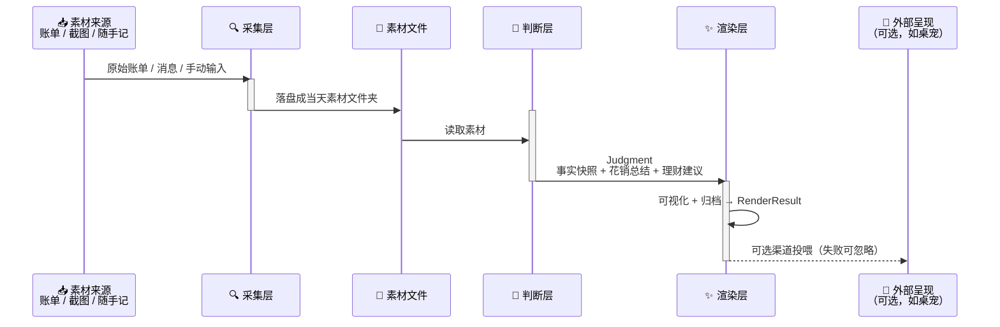

# StepLedger — 架构设计文档（RFC）

描述当前架构、边界、核心设计决策。被否决的备选方案见文末附录。

## 总体架构



管线：**采集只负责收，判断负责算与说，渲染只负责给人看**。层间以文件为界——采集层的产物是素材文件夹，判断层的输入就是它。

判断层是唯一读 `archive/` 的层：它先观察余额、再算事实、再翻旧账（趋势）、最后说话，
产出的 `Judgment` 里已经带着算好的数字。渲染层拿不到 archive 根路径，也就不可能自己再算一遍。

日常一次运行的实际顺序是 **采集(今天) → 清点(昨天) → 判断(今天) → 渲染(今天)**。清点是补偿机制：
素材是持续追加的，当天的快照永远可能不完整，第二天先把昨天重新清点一遍（素材指纹没变就一个
token 都不花），再算今天。清点只更新记录、不播报；失败不阻塞今天。见
[next-day-settle](feature-next-day-settle.md)。

渲染阶段内部再分两步：**先 `illustrate`（可选：文本模型写 prompt → 图像模型出图），再进渠道排版**。
渠道仍然零网络；图是共享产物，先给 pet，以后 console / IM 可直接复用。需求见
[每日插画](feature-pet-illustration.md)，技术见
[architecture-pet-channel.md](architecture-pet-channel.md)。

设计取向是**定性，不定量**：架构里不放精确对账、预算阈值、分类报表。判断层允许模糊、允许主观，唯一硬要求是"有温度、说人话、仅供参考"。

## 调度归属：Skill 定流程，Agent 定时间

skill 不会自己定时，它只能被调用。所以时间这件事必须交给宿主：

| 职责 | 归属 |
|------|------|
| 知道"每天该做什么" | 本 skill（流程、口味、归档约定） |
| 决定"什么时候做" | 宿主 agent 的定时 / 心跳能力 |
| 无常驻 agent 时兜底 | `scripts/daily_run.py` + 系统 cron（可选） |

skill 只表达一句话："如果宿主有定时能力，请每天在用户偏好的时间调用我一次。"具体时间由宿主决定，本仓库不假设、也不实现调度器。

由此得到三条实现约束：

1. **幂等** — 同一天被调用多次不能产生重复或错乱归档，按 `YYYY-MM-DD` 目录覆盖/追加
2. **可续跑** — agent 可能中途被打断，任一层单独重跑都应可用
3. **两入口同一产物** — agent 调用与 cron 调用必须走同一条管线，不写两套逻辑

### 长期状态放哪

目标、当前存款、偏好这类跨天状态，不放数据库，放 `materials/profile.md`。文件是单一事实源：agent 模式读它，cron 模式也读它。能用 agent 自己的记忆就用记忆，需要精确复现的才落文件。

## 模块结构

```
src/step_ledger/
├── pipeline.py       # 管线编排
├── collect/          # 层 1: 采集（只落盘，不解读）
│   └── adapters/     # 素材来源适配器
├── judge/            # 层 2: 判断（给总结与建议）
│   └── providers/    # AI Provider 适配层
├── render/           # 层 3: 渲染（插画 + 渠道投递 + 归档）
│   ├── illustration.py  # 可选：文本模型写 prompt → 图像模型出图
│   └── channels/     # 渲染渠道
└── shared/           # 跨层共享（类型 + 配置 + 路径）
```

### 各层职责

| 层 | 职责 | 输入 | 输出 |
|----|------|------|------|
| `collect` | 把各方素材收拢成文件 | 外部源 / 手动输入 | 素材文件夹 `materials/YYYY-MM-DD/` |
| `judge` | 观察余额、算事实与趋势、写总结与建议 | 素材文件夹 + 档案 + `archive/`（≤ 当天） | `Judgment`（`facts` + `trend` + 两句话） |
| `render` | 可选先生成插画，再把 `Judgment` 排版并归档 | `Judgment` + 写目录 | 渲染产物（插画/文本/图片/网页）+ 归档路径 |
| `pipeline` | 顺序编排各层 | 配置 | `PipelineResult` |

### 层间契约

- **collect → judge**：文件系统。素材目录存在且至少有一个可读文件
- **judge → render**：`Judgment` 数据类型。`facts` 由代码写、模型不可改；`summary` / `advice` 均非空
- **judge → judge**：只读 `≤ 当天` 的 `archive/`，且余额序列排除当天自身（当天的余额只来自观察）
- **render → 用户**：产物落盘到 `archive/YYYY-MM-DD/`，或直接输出到终端

判断层内部还有一条契约：`observe()` 只读数、`speak()` 只写字，算术只在 `judge/facts.py` 里发生。
观测的可信度靠「摘录必须能在素材原文里找到」做机械核验，不靠模型自我评价。

### 扩展点

- **素材来源**：继承 `BaseAdapter`，实现 `collect() -> Path`（返回当天素材目录）
- **AI Provider**：继承 `BaseProvider`，实现 `observe(materials_text, date) -> Observation`
  与 `speak(materials_dir, profile, date, facts, trend) -> Judgment`
- **图像 Provider**（草案）：实现 `generate(prompt, refs) -> bytes`；第一版只接 Ark Seedream，
  不引第三方 SDK
- **渲染渠道**：继承 `BaseChannel`，实现 `render(judgment: Judgment) -> Path | str`

## 当前实现状态

- [x] 项目脚手架（目录结构、文档骨架、环境配置）
- [x] 类型定义（`shared/types.py`：`Judgment`、`CollectResult`、`RenderResult`、`PipelineResult`）
- [x] 配置模块（`shared/config.py` + 素材/归档路径约定）
- [x] `materials/profile.md` 约定（目标 / 存款 / 偏好）与读取逻辑
- [x] 素材来源适配器（手动：一段文字 / 一个文件 / 一个目录；素材夹：快捷指令写入的目录按日期只收当天）
- [x] Stub 判断层（不调模型，返回固定语气模板）
- [x] 控制台渲染渠道（`report.md` + `milestones.md` + 终端直显）
- [x] 管线编排（`pipeline.run`，各层可单独重跑）
- [x] cron 入口脚本（`scripts/daily_run.py`）
- [x] 真实 AI Provider（OpenAI 兼容，失败自动降级到 stub）
- [x] 测试（冒烟 / 契约 / 隐私扫描）
- [x] 桌宠播报渠道 `pet`（渲染层只写 `pet_task.md` 简报，由宿主 agent 用
  `scripts/pet_play.py` 决定说什么、播什么；架构见
  [architecture-pet-channel.md](architecture-pet-channel.md)，需求见
  [feature-pet-channel.md](feature-pet-channel.md)）
- [x] 每日插画 `illustrate`（MVP：文本模型写 prompt → Ark Seedream 出图；失败跳过，
  需求见 [feature-pet-illustration.md](feature-pet-illustration.md)，架构见
  [architecture-pet-channel.md](architecture-pet-channel.md)）

### 实现备注

- 入口：`scripts/daily_run.py`（cron 兜底）、`python -m step_ledger`、`step-ledger`（安装后）
- 分阶段：`--stage collect|judge|illustrate|render`，用于补投素材与断点续跑
- 自动素材夹：`COLLECT_SOURCE_DIRS`（逗号分隔，可指向 iCloud 等被快捷指令写入的目录）；
  `--source` 可临时覆盖。文件归属日期优先取文件名里的 `20261028` / `2026-10-28`，没有才看修改时间；
  同名源文件按原文件名覆盖成当天最新快照（源文件当天追加不会变成多份素材）
- `judgment.json` 里 `facts` 存当天事实（`goal` / `month` / `pace`），`trend` 存近两周趋势与
  进度历史，`observation` 存模型的原始观测（含原文摘录），`runtime` 只存运行信息（provider /
  usage / steps / degraded_reason）。`meta` 已退役，旧文件读取时自动迁移
- 真实 provider 只需 `JUDGE_PROVIDER=openai` + `JUDGE_API_KEY`，其余走 `.env` 默认值
- `judgment.json` 的 `runtime.usage` 记录 token 用量
- 存款来源：`materials/profile.md` 优先；没填时用观察步读到的余额兜底，`facts.goal.savings_source`
  标 `balance` 并在报告里写「按素材余额估算」（卡内余额 ≠ 总存款，所以口径写在脸上）
- 空素材日不调模型：0 份素材时观察与说话都跳过，`runtime.provider = "none"`、`runtime.steps`
  记 `skipped` / `stub`；但事实仍由历史余额算出，降级路径也有数字
- 采集自证：CLI 普通输出打一行 `采集：共 N 份素材；<跳过的原因>`，`--json` 时 stdout 仍只有 JSON
- 发送前过滤一次性口令：`read_materials` 摘掉含验证码/校验码/动态码的行，素材文件本身不动
- 当月累计与可花：`judge/facts.py` 用月初前最后余额与当前余额相减算已花；`月收入 − (每月需存 − 公积金月缴存)` 算出本月可花，剩余为负即缺口。读不到当天余额就退回「上一个有余额的日子」，并标 `spent_as_of`
- 每日节奏也在 `judge/facts.py` 里算：日额度、累计允许、结余/超支、明日额度；模型只负责措辞，不参与计算
- 趋势产物：`archive/<日期>/trend.svg` 与 `trend.csv`，数据源是 `judgment.trend.days`（判断层
  从 `≤ 当天` 的余额序列拼好），按自然日补空、缺口不连成假线；SVG 是 W3C 标准矢量图
  （零依赖、坐标精确），CSV 供任何表格工具重画
- `materials/profile.md` 的 `约定：` 分两种：`键 = 值` 进 `Profile.agreements`（代码可用），
  其余原话进 `Profile.notes`；两者都会进 prompt，`目标日期` 还会额外算成「还剩几个月 / 每月要存多少」

## 未决问题

1. 素材格式：当前只解析文本类（`.md` / `.txt` / `.csv` / `.json`），图片 OCR 未做
2. 图形化渲染：先做终端文本 + markdown，HTML / 图片渠道待补
3. 素材保留策略（只留最近 N 天 vs 永久）
4. 漏跑补账：采集只认当天日期，某天没跑管线，那天的源文件就进不了账本（10-29 的三笔即此例）。
   补法要么在 `run()` 里扫历史缺口逐日补判断，要么手工 `--date` 重投一次；目前选后者，先不做自动补

## 附录：Alternatives Considered & Why

| 决策点 | 选择 | 被否决方案 | 原因 |
|--------|------|-----------|------|
| 语言 | Python | TypeScript | agent skill 场景下脚本依赖轻，Python 生态更成熟 |
| 架构 | 分层管线 | 单体脚本 | 各层职责差异大，需独立替换/测试 |
| 层间通信 | 素材文件夹 + 轻量 dataclass | 全程强类型内存对象 | 素材天然异构、来源不固定，落盘更好扩展也能回放 |
| 解读风格 | 定性 + 有温度 | 精确记账 / 预算管控 | 精确对账成本高、体验冷，用户坚持不下来 |
| 适配器模式 | 基类继承 | 硬编码 if-else | 素材来源/渲染渠道会持续增加 |

- **次日清点**：`--stage all` 的日常运行会先清点昨天（`PIPELINE_LOOKBACK_DAYS` 控制天数，默认 1）。
  判据是 `runtime.materials_digest`（文件名 + 字节），没变就 0 调用、0 写入；变了整份重判，
  但只渲染非播报渠道（`BaseChannel.broadcast`），不写 `pet_task.md`
- **清点失败不阻塞**：整段包在 try/except 里，原因写进当天的 `render.log`；模型降级时宁可
  不写盘也不覆盖原文，下次运行自愈
- **重算为准**：`judgment.json` 是缓存。`--stage render` 发现档案比 judgment 新、或旧归档还没有
  事实快照时会先重算这一天；素材已清理的旧日子只补事实、保留原文并标 `facts_backfilled`
- **全量重算**：`--rebuild` 逐天重跑所有归档日；改过档案口径想统一历史时用它
- **手动清点**：`--settle [--date D]`，默认清点昨天；单独修一天时用它
- **两段模型调用**：`observe()` 温度 0 只读数，`speak()` 温度 0.7 只写字；摘录核验由代码做
