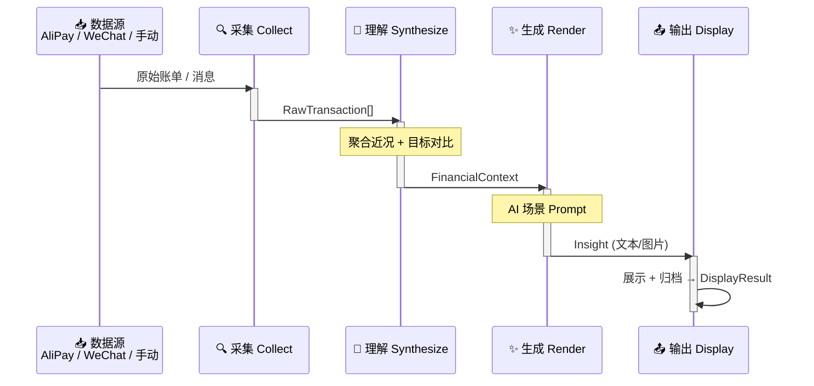

# StepLedger — 技术实现 Skill

## 总体管线

## 扩展模式

- **数据源**：在 `collect/adapters/` 下新增适配器，继承 `BaseAdapter`
- **AI Provider**：在 `render/providers/` 下新增 provider，继承 `BaseProvider`
- **输出渠道**：在 `display/channels/` 下新增渠道，继承 `BaseChannel`

## 运行入口

- `scripts/daily_run.py` — cron 每日触发入口
- 手动调试：`python -m step_ledger.pipeline`

## 关键约束

1. 凭证走 `.env`，不进仓库
2. daily prompt 和输出归档到 `archive/YYYY-MM-DD/` 目录
3. 每个阶段可独立替换和测试
